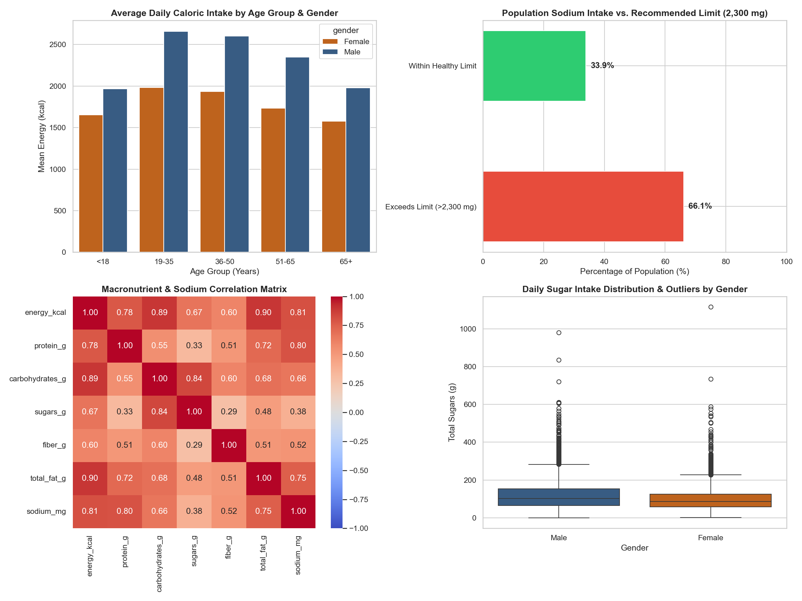
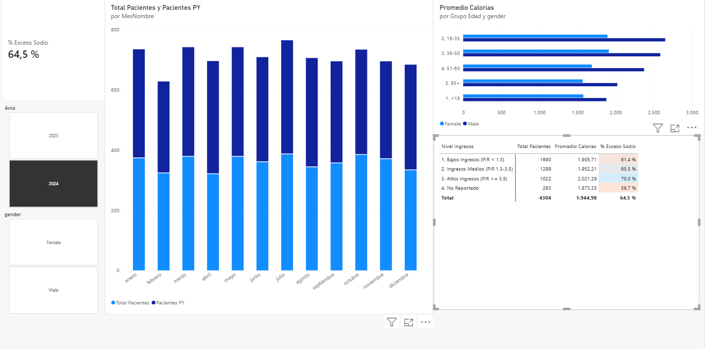

# 🥗 NHANES Nutritional Profile & Macronutrient Intake Analysis (EDA)

## 📌 Executive Summary
This project executes an end-to-end data engineering and exploratory data analysis (EDA) pipeline using real-world epidemiological records from the **National Health and Nutrition Examination Survey (NHANES)**. 

By integrating demographic records (`10,175` individuals) with 24-hour dietary recall data (`9,813` records across `168` variables), this pipeline filters, normalizes, and consolidates a high-quality analytical dataset of **`8,531` validated patients** to uncover population-level dietary risk factors, macronutrient correlations, and sugar intake anomalies.

---

## 📊 Visual Dashboard


---
---

---

## 📈 Interactive Business Intelligence Dashboard (Power BI & DAX)


### Star Schema & Data Modeling
The processed dataset (`8,531` patients) feeds directly into a **Power BI Star Schema** model, connecting the central clinical fact table (`Pacientes`) with a dynamic master date dimension (`Calendario`) via a `1:*` (One-to-Many) relationship.

### Key DAX Measures & Calculated Columns
- **Dynamic Sodium Risk Prevalence (`CALCULATE` & `DIVIDE`)**:
  ```dax
  % Exceso Sodio = 
  VAR PacientesRiesgo = CALCULATE([Total Pacientes], Pacientes[sodium_mg] > 2300)
  VAR TotalGeneral = [Total Pacientes]
  RETURN DIVIDE(PacientesRiesgo, TotalGeneral, 0)
  Time Intelligence YoY Comparison (SAMEPERIODLASTYEAR):Pacientes PY = CALCULATE([Total Pacientes], SAMEPERIODLASTYEAR(Calendario[Date]))
  Demographic & Socioeconomic Segmentation (SWITCH TRUE):
Implemented dynamic age-group binning (<18 to 65+) and Poverty Income Ratio (PIR) brackets (Low, Middle, High, and Unreported via ISBLANK).
## 🎯 Key Analytical & Clinical Insights

1. **Critical Sodium Overconsumption (`66.1%` Prevalence)**: 
   nearly two-thirds (**`66.1%`**) of the evaluated population exceed the maximum daily sodium intake recommended by the WHO/AHA (`2,300 mg/day`), while only **`33.9%`** remain within healthy cardiovascular limits.
2. **Macronutrient Drivers & Hidden Sodium Sources**: 
   Pearson correlation analysis reveals that total caloric intake (`energy_kcal`) is primarily driven by total fat ($r = 0.90$) and carbohydrates ($r = 0.89$). Furthermore, sodium exhibits a strong positive correlation with energy ($r = 0.81$), protein ($r = 0.80$), and total fat ($r = 0.75$), but a weak association with sugars ($r = 0.38$)—indicating that sodium excess is heavily linked to savory protein-dense and fatty processed foods rather than sweet foods.
3. **Empty Calories & Fiber Disconnect**: 
   Total sugar intake (`sugars_g`) correlates strongly with total carbohydrates ($r = 0.84$), yet shows minimal correlation with dietary fiber ($r = 0.29$) and protein ($r = 0.33$), highlighting the impact of refined sugars and sugar-sweetened beverages lacking satiety nutrients.
4. **Demographic Caloric Peaks & Sugar Outliers**: 
   Daily caloric intake peaks among young adult males aged **19–35** (exceeding `2,600 kcal/day` on average) before declining progressively after age 50 across both genders. While median sugar consumption sits near `100 g/day`, boxplot distributions expose extreme positive skewness with outliers exceeding `600 g` to `1,000 g/day`.

---

## 🛠️ Tech Stack & Pipeline Architecture
- **Language**: Python 3.13
- **Data Engineering & Wrangling**: `Pandas`, `NumPy` (Relational `INNER JOIN` on `SEQN`, schema reduction from 215 raw columns to 11 core features, null removal, and demographic age-binning).
- **Data Visualization**: `Matplotlib`, `Seaborn` (2x2 executive subplot grid).
- **Version Control**: `Git` & `GitHub` (Conventional Commits workflow).
- **SQL Analytics**: `SQLite3` (In-memory relational querying using `CTEs`, `CASE WHEN`, `COALESCE`, and manual pivoting).
- **Business Intelligence**: `Power BI Desktop` & `DAX` (Star Schema modeling, Time Intelligence `YoY`, and conditional matrix formatting).
---

## 📂 Repository Structure
```text
├── data/
│   ├── raw/                        # Raw NHANES CSV files (ignored in Git)
│   └── processed/                  # Clean dataset (8,531 rows) & dashboard PNG
├── src/
│   ├── inspect_data.py             # Initial data profiling and schema auditing
│   ├── clean_pipeline.py           # ETL script: merges and cleans raw tables
│   └── exploratory_analysis.py     # Generates statistical insights and 2x2 plots
├── .gitignore                      # Excludes raw data dumps and cache files
├── requirements.txt                # Python environment dependencies
└── README.md                       # Executive documentation